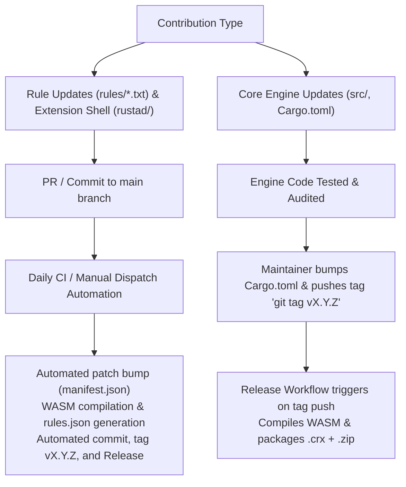

# Contributing to Rustad

Thank you for your interest in contributing to **Rustad**! 

Rustad (`rust` + `ad`) is an ultra-lightweight, browser-agnostic ad blocking engine written in pure standard Rust with **zero external dependencies**, compiled to WebAssembly and deployed as a high-speed Chrome Manifest V3 extension.

---

## 🎯 Core Philosophy & Standards

> **"An ad is an ad. Rustad is designed to be extreme at ad blocking."**

Rustad operates on uncompromising foundational principles:
1. **Zero Tolerance for Ads & Trackers**: We do not participate in "Acceptable Ads" programs. There are no paid exemptions, no sponsored whitelists, and no compromises for tracking or analytics.
2. **Zero Crates.io Dependencies**: The Rust engine (`Cargo.toml`) has **0** external crates. It compiles exclusively against Rust `core` and `std`. Every parser, pattern matcher, and byte generator is handcrafted for maximum auditability, security, and minimal WASM footprint.
3. **Browser-Agnostic Core**: The core engine in `src/` knows nothing about Chrome or browser DOM APIs. It can run in Node.js, Cloudflare Workers, desktop browsers, or native CLI applications.
4. **Zero-Allocation Hot Paths**: URL matching, domain lookups, and cosmetic rule retrievals operate over baked static memory slices without heap allocations on every request.

---

## 🚦 The Two Release Tracks (Important!)

Rustad separates **Engine Core** releases from **Extension & Ruleset** releases. Understanding this distinction is vital before contributing:



### 1. Extension & Ruleset Track (Automated Daily Routine)
The primary day-to-day contributions are improvements to our ad blocking rules (`rules/domains.txt`, `rules/patterns.txt`, `rules/cosmetics.txt`, `rules/scriptlets.txt`).

> [!CAUTION]
> **HARD RULE: DO NOT manually create Git tags or commit version bumps for rule updates.**
> 
> When contributing rule fixes or UI improvements:
> - Submit your changes via a standard Pull Request to `main`.
> - Do **not** touch `rustad/manifest.json` version numbers.
> - Do **not** push version tags (`v*`).
> - The automated GitHub release workflow runs daily (and can be triggered manually). It automatically detects unreleased changes, increments the extension patch version in `rustad/manifest.json`, builds `rustad.wasm`, regenerates `rustad/rules.json`, commits `[skip ci]`, tags the release, and publishes `.crx` and `.zip` packages.

### 2. Core Engine Release Track (Manual Tag Releases)
When architectural or algorithmic changes are made to the Rust engine (`src/`):
- Maintainers update `Cargo.toml` and verify all tests pass.
- Maintainers push a version tag:
  ```bash
  git tag v0.2.0
  git push origin v0.2.0
  ```
- The release workflow recognizes the tag push (`push: tags: ['v*']`), runs all tests and linters, synchronizes the release packages, builds `.crx` and `.zip`, and publishes the GitHub Release directly for that tag without recursive tag creation.

---

## 🛡️ Rule Curation Standards

All rules live under the [rules/](file:///home/nolan/works/rustad/rules) directory and are assembled into static code at compile-time by [build.rs](file:///home/nolan/works/rustad/build.rs).

### 1. Domain Blocklist (`rules/domains.txt`)
Blocks entire ad networks, tracking domains, and telemetry endpoints at the DNS/network level via DeclarativeNetRequest.

- **Format**: Clean Fully Qualified Domain Name (FQDN) per line.
  ```text
  doubleclick.net
  adservice.google.com
  criteo.com
  ```
- **Rules**:
  - **NO schemes**: Never include `http://` or `https://`.
  - **NO paths**: Never include slashes or paths (e.g., `example.com/ads` is forbidden).
  - **NO leading wildcards**: Do **not** prefix with `*.` or `*` (the engine already matches all subdomains automatically!).
  - **ASCII Only**: Punycode (`xn--...`) must be used for internationalized domain names.
  - **One domain per line**: No inline comments or trailing spaces.

### 2. Pattern Matcher (`rules/patterns.txt`)
Filters URL paths, query parameters, and dynamic ad scripts.

- **Format**: DeclarativeNetRequest `urlFilter` pattern per line.
  ```text
  /adsbygoogle.js
  *banner-ad*
  ||example.com/adverts/*
  ```
- **Rules**:
  - **ASCII Only**: Chrome DNR strictly rejects non-ASCII characters in `urlFilter`.
  - **NO Cosmetic Syntax**: Never put `#?#`, `##`, or element selectors in `patterns.txt`.
  - **Valid Anchors Only**:
    - `||` matches the domain boundary.
    - `|` at the start or end matches the exact URL boundary.
    - `^` matches a separator character (slash, colon, question mark).
    - **Never mix anchors**: `||*ad-server` is invalid DNR syntax; use `||ad-server` instead.

### 3. Cosmetic Selectors (`rules/cosmetics.txt`)
Hides advertising containers, banners, sponsored cards, and layout blanks that network filtering alone cannot remove.

- **Format**: Standard element selectors or domain-specific selectors.
  ```text
  # Generic global selectors
  [id^="ad-slot-"]
  .adsbygoogle
  .trc_related_container

  # Domain-specific selectors
  youtube.com##ytd-ad-slot-renderer
  cnn.com##.ad-rail
  reddit.com##shreddit-ad-post
  ```
- **Rules**:
  - Keep generic selectors **surgical**: never use overly broad selectors like `div.banner` or `.box` that might collapse legitimate page content.
  - For site-specific ad containers, prefix with `domain.com##`.
  - Rustad injects these with high-specificity styling (`display: none !important; opacity: 0 !important; height: 0 !important; ...`).

### 4. Main-World Scriptlets (`rules/scriptlets.txt`)
Defuses inline ad engines, video player pre-rolls, and anti-adblocker bait at runtime.

- **Format**: `domain.com##+js(defuser_name, arg1, arg2)`
  ```text
  youtube.com##+js(defuse_yt_player_ads)
  cnn.com##+js(set_property, cnnAdEngine, undefined)
  ```
- **Security & Prototype Safety**:
  - Scriptlets execute in Chrome's `MAIN` execution world (immune to site CSP).
  - Scriptlets must **never** mutate `__proto__`, `prototype`, or `constructor` to prevent prototype pollution vulnerabilities.

### 5. Exception Rules (`rules/exceptions.txt`)
Unbreaks essential site features that may be inadvertently blocked.

- **STRICT RESTRICTION**: Exceptions are granted **solely** for functional unbreaking of organic content (e.g., login flows, genuine site assets).
- **Hard Rule**: No exceptions are ever granted for third-party ad networks, telemetry beacons, or tracker domains.

---

## 💻 Development & Testing Guide

### Prerequisites
- Standard Rust toolchain (1.75+): `rustup default stable`
- WebAssembly target: `rustup target add wasm32-unknown-unknown`
- Node.js (for `.crx` packaging tool `crx`): `node -v`

### Building the Project
```bash
# 1. Run engine tests
cargo test

# 2. Run Rust linter with zero-warning tolerance
cargo clippy --all-targets -- -D warnings

# 3. Compile WebAssembly engine release
cargo build --target wasm32-unknown-unknown --release
cp target/wasm32-unknown-unknown/release/rustad.wasm rustad/rustad.wasm
```

### Testing the Extension in Chrome
1. Open Google Chrome (or Brave, Edge, Chromium).
2. Navigate to `chrome://extensions`.
3. Enable **Developer mode** (toggle in the top-right corner).
4. Click **Load unpacked** and select the [rustad/](file:///home/nolan/works/rustad/rustad) directory.
5. Visit ad-heavy websites (e.g. YouTube, CNN, Forbes) and verify that:
   - Ad requests are blocked in the Network panel.
   - Ad containers are surgically hidden with 0 layout shift.
   - The popup badge correctly increments and reflects blocked ads.
   - The console displays no CSP errors or script crashes.

---

## 📝 Pull Request Checklist

Before submitting a PR:
- [ ] Added/modified rules conform strictly to the curation standards above.
- [ ] `rules/patterns.txt` contains zero non-ASCII characters and zero cosmetic selectors.
- [ ] `Cargo.toml` contains **0** external crates.io dependencies.
- [ ] `cargo test` passes 100% of tests.
- [ ] `cargo clippy --all-targets -- -D warnings` reports 0 warnings.
- [ ] No manual version bumps in `rustad/manifest.json` (automated releases handle this).
- [ ] Verified locally in Chrome that targeted ads are eliminated without site breakage.

Thank you for helping keep the web clean, private, and lightning fast with **Rustad**! 🦀🛡️
